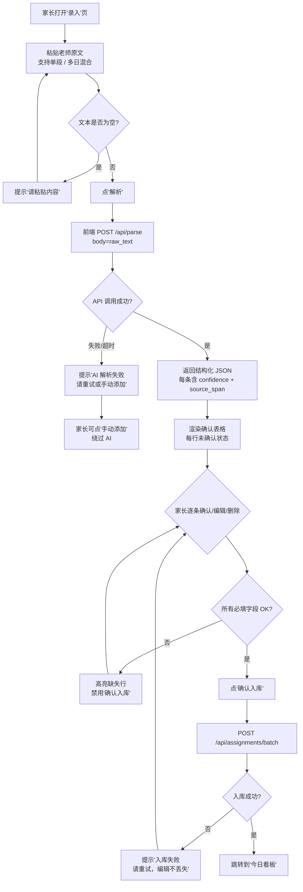
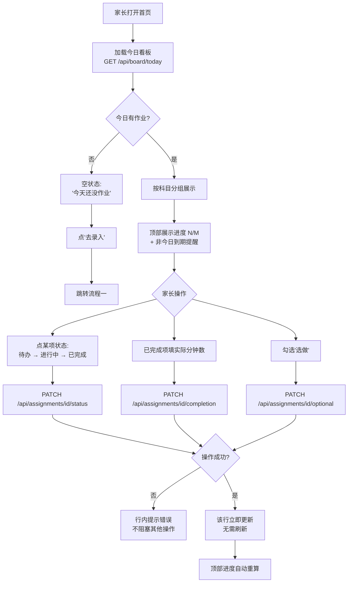
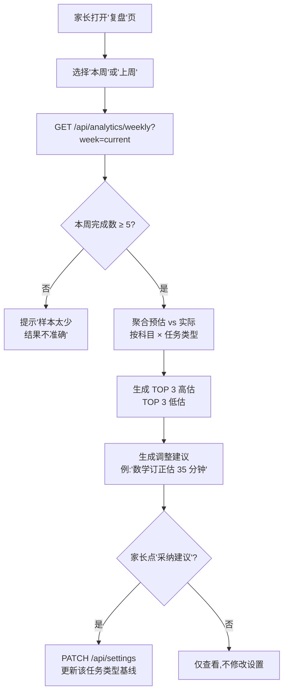

# 小学生学习跟踪平台 v1 · 功能设计文档（PRD）

> 文档版本：v1.0 · 编写日期：2026-09-28 · 作者：商觅（product）
> 技术环境（已勘察）：WSL2 / Python 3.12.3 / Node v26.8.1 / fastapi 0.135.2 / pydantic 2.12.5 / requests 2.33.1
> AI 能力：固定 MiniMax 国内站 `https://api.minimaxi.com`，Key 走环境变量 `MINIMAX_API_KEY`

---

## 1. 问题定义与目标用户

### 1.1 现状（来自真实素材）

家长（主理人）孩子读三年级，每天老师把作业发到家长群。家长要做三件重复劳动：

1. **结构化**：把一段混杂中文标点 + emoji + 多日期 + 多科目的文本，逐条拆成「科目 / 任务描述 / 日期 / 截止时间 / 是否选做」。
3. **预估**：凭印象给每条估个耗时，贴到备忘录或群里。
5. **追踪**：晚上问孩子"今天作业做完没"，孩子答"做完了"但其实没做完或漏了一项。

这个过程每天 15~30 分钟，重复 180 天/学年，**无法沉淀，也无法用实际数据校准"我的预估到底准不准"**。

### 1.2 目标用户

| 角色 | 关系 | 用平台的频率 | 关心什么 |
|---|---|---|---|
| **家长**（主理人） | 直接用户，每天操作 | 每天 2~5 次 | 省时间、可信、可量化 |
| **孩子**（三年级 8~9 岁） | 间接受益者 | 不直接操作 | 作业不被漏、被打卡不烦 |

**v1 不做孩子的独立账号**——孩子通过家长口头汇报完成状态，家长代为打卡。

### 1.3 v1 成功后，家长每天省下什么

| 维度 | 现在 | v1 后 |
|---|---|---|
| 解析通知 | 手工 10~15 分钟/科 × 3 科 | 粘贴 → 确认 → 入库，**单次 ≤ 3 分钟** |
| 找历史预估 | 翻群消息或备忘录 | 系统按"科目 + 任务类型"自动给基线预估 |
| 确认完成情况 | 晚上反复追问孩子 | 看板一眼看到 N/M 完成 + 实际耗时 |
| 漏听写/漏带作业 | 经常发生 | 截止时间字段自动提示 |
| 周复盘 | 无 | 看到本周"估时偏差 TOP 3"，知道哪科自己估得离谱 |

**核心价值：把"每天的重复劳动"压缩到 3 分钟内，并把经验沉淀成数据。**

---

## 2. 核心用户故事

### 2.1 解析与录入（4 条）

1. **作为家长**，我希望把老师发的通知原文整段粘贴进输入框，让系统自动拆成「科目 + 任务 + 日期 + 截止时间」，**以便**我不必手工一行行抄写。
2. **作为家长**，我希望 AI 拆出的每一条任务都能让我**确认 / 修改字段 / 删除**，**以便**我对内容负责，不被 AI 误判坑到。
3. **作为家长**，我希望一次性粘贴一周的通知原文也能解析正确，**以便**周末补录时不必一段段重复操作。
4. **作为家长**，我希望每条解析出的任务都能**点回去看原文哪一段对应**，**以便**我不放心时核对老师原话。

### 2.2 看板与打卡（3 条）

5. **作为家长**，我希望打开应用看到**今天的看板**（按语文/数学/英语分组），**以便**随时知道还剩几项、孩子做了几项。
6. **作为家长**，我希望孩子完成一项就能**勾掉 + 录一个实际分钟数**，**以便**沉淀真实数据，让系统下次估得更准。
7. **作为家长**，我希望有截止时间不是今天的作业（比如周四听写）能**单独在"待办·非今日"**里提醒我，**以便**不会忘记。

### 2.3 复盘与设置（2 条）

8. **作为家长**，我希望周末能看到**本周预估 vs 实际**的偏差分析（哪科估高估低 TOP 3），**以便**下次给同类型任务估时心里有数。
9. **作为家长**，我希望设置里能调**每科基线预估**（比如"数学计算练习 10 分钟"），**以便** AI 在历史样本不足时用我的偏好兜底。

### 2.4 信任与边界（1 条）

10. **作为家长**，我希望 AI 给出的每条任务都明确标记**置信度**（高/中/低），**以便**我对"低置信度"那条多看一眼原文，避免漏任务。

---

## 3. 功能清单

### 3.2 P0（v1 必做）

#### F1 · 老师通知原文粘贴解析

- **用户操作**：在"录入"页粘贴一段老师通知原文，点「解析」
- **系统响应**：
  1. 调用 MiniMax API 进行结构化抽取
  2. 返回结构化 JSON 数组，每个元素包含 `subject, task_name, due_date, deadline_time, is_optional, est_minutes, confidence, source_span`
  3. 渲染一个确认表格，**每一行默认是未确认状态**
- **边界情况**：
  - 文本为空 → 提示"请粘贴内容"
  - API 超时（>15s） → 显示"AI 解析失败，请重试或手动添加"，不阻塞手动添加按钮
  - 解析为空数组 → 提示"未识别到任何作业，请检查原文或手动添加"
  - 同一文本二次提交 → 提示"该文本已解析过，是否覆盖？"，列出已存在条数

#### F2 · 解析结果二次确认/编辑界面

- **用户操作**：在确认表格里编辑字段、勾掉不想要的行、点「确认入库」
- **系统响应**：
  - 实时校验：`due_date` 不能晚于今天 +30 天；`est_minutes` 必须在 1~180 之间
  - 「确认入库」后写入数据库，跳转到"今日看板"
- **边界情况**：
  - 必填字段为空 → 那一行高亮，禁用「确认入库」
  - 家长删掉了所有行 → 提示"至少保留一行，或返回重新解析"
  - 入库失败（DB 异常） → 提示"入库失败，请重试"，不丢失当前编辑

#### F3 · 今日看板

- **用户操作**：打开应用首页，看到今日所有作业，按科目分组
- **系统响应**：
  - 每行显示：科目标签 / 任务名 / 预估分钟 / 状态按钮（待办 → 进行中 → 已完成）/ 实际分钟输入框（完成后填）
  - 顶部显示进度：`已完成 N / 总 M`
  - "选做"任务单独折叠在最下方，默认收起
- **边界情况**：
  - 今日无作业 → 显示空状态："今天还没有作业，点这里录入"
  - 跨日使用（凌晨 2 点）→ 仍显示"今天"日期，但加一行小字"已是凌晨，注意休息"
  - 同一任务跨日（比如「订正 1 号作文本」连续 2 天）→ 看板只显示当日条目，**历史条目不暴露**

#### F4 · 作业列表（按日期查询）

- **用户操作**：点日历上的某一天，看那天的所有作业
- **系统响应**：
  - 显示该日所有作业 + 完成率
  - 支持查看「过去 7 天」「过去 30 天」
- **边界情况**：
  - 那天没有作业 → 显示空状态
  - 那天是过去日期 → 状态按钮禁用，只能查看历史打卡记录

#### F5 · 截止时间字段与"待办·非今日"提醒

- **用户操作**：在今日看板顶部，看到一条黄色提示："⚠ 有 N 项作业截止不在今天，本周要做：周四 8:20 英语听写、..."
- **系统响应**：
  - 解析时识别 `deadline_time`（如"周四早读 8:20"）
  - 在首页顶部固定展示这一周内所有"非今日到期"的作业
- **边界情况**：
  - 截止时间已过 → 该条目置灰，但仍可见
  - 截止时间无法识别 → 置信度标低，不进入提醒列表

#### F6 · 选做标记

- **用户操作**：在确认页面，对每一条任务勾选"选做 / 部分同学适用"
- **系统响应**：
  - 看板里"选做"分组折叠
  - 周复盘时选做任务的实际耗时**不计入**估时偏差统计
- **边界情况**：
  - 家长没勾选 → 默认"必做"
  - AI 识别为"部分同学适用"但家长判断这孩子适合 → 可取消选做标记

#### F7 · 周期复盘页（周维度偏差分析）

- **用户操作**：在"复盘"页选择"本周 / 上周"
- **系统响应**：
  - 显示"预估 vs 实际"偏差表：按科目 × 任务类型聚合
  - TOP 3 高估任务（实际远低于预估）、TOP 3 低估任务（实际远超预估）
  - 给一句话建议："数学'订正'类作业你平均估 20 分钟，实际 35 分钟，建议下次估 35 分钟"
- **边界情况**：
  - 本周完成数 < 5 → 提示"样本太少，复盘结果不准确"
  - 无任何实际耗时录入 → 不生成偏差表，只显示"还没记录实际耗时"

#### F8 · 设置项

- **用户操作**：在"设置"页配置年级、孩子作息、单科基线预估、解析模型参数（仅调试用）
- **系统响应**：
  - 「年级」：三年级（v1 固定，下版本扩展）
  - 「单科基线预估」：语文 / 数学 / 英语 → 默认基线分钟数（如数学 15 分钟、语文 20 分钟）
  - 「作息」：默认放学时间、晚饭时间（影响"今日截止时间"提示）
  - 「解析模型」：仅显示当前模型版本，不允许切换（v1 固定）
- **边界情况**：
  - 修改基线预估 → 不影响历史记录，只影响未来解析
  - 设置项为空 → 用系统默认值

#### F9 · 数据导出（本地备份）

- **用户操作**：在"设置"页点「导出全部数据」
- **系统响应**：
  - 生成 JSON 文件下载到本地
  - 文件名：`study-tracker-export-YYYYMMDD-HHmm.json`
- **边界情况**：
  - 数据库为空 → 仍生成空文件，提示"暂无数据"
  - 导出失败 → 显示具体错误，不静默

---

### 3.3 P1（v1.1 候选）

| 功能 | 说明 |
|---|---|
| F10 · 多孩子支持 | 同家庭多个孩子，切换孩子身份 |
| F11 · 邮件 / 微信通知自动采集 | 邮件解析或微信群机器人 |
| F12 · 番茄钟 / 专注计时 | 孩子写作业的计时功能 |
| F13 · 错题本 | 拍照 + 标签管理 |
| F14 · 老师评价反馈录入 | 单元测验分数、老师评语 |
| F15 · 提醒推送（家长手机） | PWA 推送 / 系统通知 |
| F16 · 解析历史回看 | 查看过去每次解析的原始文本与结果 |
| F17 · 自定义任务类型 | 比如"课外阅读""兴趣班" |

---

### 3.4 P2（暂不做）

- 账号体系、多人协作、云端部署
- 孩子直接操作（独立 App / 小程序）
- 老师直接对接（家校通 API）
- 班级 / 年级排行 / 同伴比较
- 学科知识点掌握度建模
- 图像化报表（图表、雷达图）—— v1 只用表格
- AI 模型切换 / 多模型对比
- 语音录入 / 图片 OCR 识别老师通知（v1 仅支持纯文本粘贴）

---

## 4. 关键用户流程

### 4.1 流程一：粘贴老师通知 → 清单入库



### 4.2 流程二：每日看板 → 逐项打卡 → 录入实际耗时



### 4.3 流程三：周期复盘 → 预估偏差分析



### 4.4 边界：解析原文含多日/多科/异常字段

以「9.21 真实原文」为例，AI 必须输出以下结构化结果：

| source_span | subject | task_name | due_date | deadline_time | is_optional | est_minutes | confidence | 备注 |
|---|---|---|---|---|---|---|---|---|
| 一起作业 | 英语 | 一起作业（U1） | 2026-09-21 | — | false | 15 | true | AI 可推断 unit |
| 描写本 P11-12 | 英语 | 描写本 P11-12 | 2026-09-21 | — | false | 20 | true | — |
| 背课文 P18-19 | 英语 | 背诵 P18-19 | 2026-09-21 | — | false | 15 | true | 预估含 2~3 遍复读 |
| 完成知能 P14 | 语文 | 完成知能 P14 | 2026-09-21 | — | false | 25 | true | — |
| 订正 1 号作文本《猜猜他是谁》 | 语文 | 订正作文《猜猜他是谁》誊抄到 2 号 | 2026-09-21 | — | false | 30 | true | 跨两步任务 |
| 阅读课外书 | 语文 | 阅读课外书 | 2026-09-21 | — | false | 20 | false | 实际时长家长自定义 |
| 订正知能 P10-11 | 数学 | 订正知能 P10-11 | 2026-09-21 | — | false | 15 | true | — |
| 预习书本 P16-17 | 数学 | 预习 P16-17 + 1 千米体验记录单 | 2026-09-21 | — | false | 20 | true | 通勤观察 1 千米不算 |
| 练计算 | 数学 | 计算练习（学到哪写到哪） | 2026-09-21 | — | false | 10 | false | 任务粒度模糊 |
| **背诵 U2 指南重点短语** | **英语** | **背诵 U2 指南重点短语和句子** | **2026-09-22** | **2026-09-25T08:20** | **false** | **15** | **true** | **deadline_time = 周四早读 8:20 听写** |
| 1 千米体验记录单（可打印可手画） | 数学 | 1 千米体验记录单（可打印） | 2026-09-22 | — | false | 10 | true | 家长可能打印 |
| 第一单元综合复习 | 数学 | 第一单元综合复习 | **2026-09-22** | — | false | 30 | false | **9.22 是中秋假期日期，归属家长当日确认** |
| 手指记忆法练习 | 数学 | 手指记忆法练习 | **未指定** | — | **true** | — | — | **"有部分同学还未理解" → 选做 + 无日期** |

**对家长来说**：这一段文本要拆成 13+ 条任务，其中 1 条有"周四早读 8:20"的截止时间、1 条属于"假期任务"无具体日、1 条是"部分同学适用"选做、1 条实际是通勤观察不算写作业。

---

## 5. 数据模型

> ORM：SQLAlchemy + pydantic（v1 用 SQLite 单文件，路径 `./data/study.db`）

### 5.1 实体：Assignment（作业项）

| 字段 | 类型 | 约束 | 说明 |
|---|---|---|---|
| `id` | int (PK) | autoincrement | 主键 |
| `subject` | enum | not null, in ['语文','数学','英语'] | 科目 |
| `task_name` | str | not null, length ≤ 200 | 任务名（家长可改） |
| `due_date` | date | not null | 归属日期（哪天的作业） |
| `deadline_time` | datetime \| null | — | 截止时间（非当日截止时填） |
| `is_optional` | bool | default false | 选做标记 |
| `est_minutes` | int | 1~180 | 预估时长（分钟） |
| `actual_minutes` | int \| null | 0~240 | 实际时长（完成后填） |
| `status` | enum | default 'todo', in ['todo','doing','done','skipped'] | 状态 |
| `task_type` | str \| null | length ≤ 50 | 任务类型（订正/背诵/预习/阅读/计算/抄写...） |
| `source_span` | str | length ≤ 500 | 原文片段（点击可展开核对） |
| `confidence` | enum | in ['high','medium','low'] | AI 置信度 |
| `batch_id` | int (FK → ParsedBatch.id) | nullable | 所属解析批次 |
| `created_at` | datetime | not null, default utcnow | 创建时间 |
| `updated_at` | datetime | not null, default utcnow, onupdate utcnow | 更新时间 |

### 5.2 实体：ParsedBatch（解析批次）

| 字段 | 类型 | 约束 | 说明 |
|---|---|---|---|
| `id` | int (PK) | autoincrement | 主键 |
| `raw_text` | str | not null, length ≤ 10000 | 原始粘贴文本 |
| `parsed_at` | datetime | not null, default utcnow | 解析时间 |
| `ai_model_version` | str | not null, length ≤ 50 | 调用的模型版本（v1 固定值 "MiniMax-Image-01" 类，但文本用 MiniMax-M2 之类，由码灵确认） |
| `result_count` | int | not null | 返回的任务数 |
| `status` | enum | in ['pending','confirmed','discarded'] | 批次状态 |
| `note` | str \| null | length ≤ 500 | 家长备注 |

### 5.3 实体：CompletionLog（打卡流水，审计用）

| 字段 | 类型 | 约束 | 说明 |
|---|---|---|---|
| `id` | int (PK) | autoincrement | 主键 |
| `assignment_id` | int (FK → Assignment.id) | not null | 关联作业项 |
| `action` | enum | in ['created','status_changed','actual_logged','edited','deleted'] | 操作类型 |
| `from_value` | str \| null | length ≤ 200 | 原值 |
| `to_value` | str \| null | length ≤ 200 | 新值 |
| `at` | datetime | not null, default utcnow | 时间戳 |

### 5.4 实体：Setting（设置项）

| 字段 | 类型 | 约束 | 说明 |
|---|---|---|---|
| `key` | str (PK) | length ≤ 50 | 设置项 key |
| `value` | str | not null | 设置值（JSON 序列化字符串） |
| `updated_at` | datetime | not null, default utcnow, onupdate utcnow | 更新时间 |

**预置 key（v1）**：
- `grade`：年级（v1 固定 "3"）
- `subject_baseline_minutes`：单科基线预估 JSON `{"语文":20,"数学":15,"英语":15}`
- `task_type_baseline_minutes`：任务类型基线 JSON `{"订正":25,"背诵":15,"预习":20,"阅读":20,"计算":10,"抄写":15}`
- `school_dismiss_time`：默认放学时间 `16:30`
- `dinner_time`：默认晚饭时间 `18:30`
- `ai_model_version`：当前解析模型版本（v1 固定，由 .env 注入到配置）

### 5.5 索引与约束

- `Assignment.due_date` 上建索引（按日查询）
- `Assignment.subject + Assignment.due_date` 联合索引（看板查询）
- `Assignment.status` 上建索引（统计完成率）
- `CompletionLog.assignment_id + CompletionLog.at` 联合索引（流水回看）
- `Assignment.est_minutes`、`actual_minutes` 必须 ≥ 0；`est_minutes` ≤ 180
- `Assignment.deadline_time > due_date` 必须为 true（截止时间不可能早于归属日期）

---

## 6. API 表面建议（v1）

> 全部走 fastapi，前缀 `/api`。所有错误响应统一格式：`{"error": {"code": "STR_CODE", "message": "..."}}`

| 方法 | 路径 | 入参 | 出参 | 错误码 |
|---|---|---|---|---|
| POST | `/api/parse` | `{"raw_text": str}` | `{"batch_id": int, "items": [AssignmentDTO]}` | `4001` 文本为空 / `4002` 文本过长（>10000 字符）/ `5001` AI 调用超时 / `5002` AI 返回格式错误 |
| POST | `/api/assignments/batch` | `{"batch_id": int, "items": [AssignmentCreateDTO]}` | `{"created_ids": [int]}` | `4003` 必填字段缺失 / `4004` 字段值越界 / `4005` 批次不存在 / `5003` 入库失败 |
| GET | `/api/board/today` | — | `{"date": str, "by_subject": {"语文": [...], "数学": [...], "英语": [...]}, "progress": {"done": N, "total": M}, "upcoming_deadlines": [...]}` | — |
| GET | `/api/assignments?date=YYYY-MM-DD` | `date` | `{"date": str, "items": [AssignmentDTO]}` | `4006` 日期格式错误 |
| PATCH | `/api/assignments/{id}/status` | `{"status": "todo\|doing\|done\|skipped"}` | `{"id": int, "status": "..."}` | `4007` 状态值非法 / `4008` 作业不存在 |
| PATCH | `/api/assignments/{id}/completion` | `{"actual_minutes": int}` | `{"id": int, "actual_minutes": int}` | `4008` / `4009` 分钟数越界 |
| PATCH | `/api/assignments/{id}/optional` | `{"is_optional": bool}` | `{"id": int, "is_optional": bool}` | `4008` |
| PATCH | `/api/assignments/{id}` | `{"task_name": str, "est_minutes": int, ...}` | `{"id": int, ...}` | `4008` / `4004` |
| DELETE | `/api/assignments/{id}` | — | `{"id": int}` | `4008` / `4010` 已完成作业禁止删除（必须先改回 todo） |
| GET | `/api/analytics/weekly?week=current\|last` | `week` | `{"week_start": str, "week_end": str, "by_type": [...], "top_overestimate": [...], "top_underestimate": [...], "sample_size": int}` | `4011` 样本不足 |
| GET | `/api/settings` | — | `{"items": [{"key": str, "value": str}]}` | — |
| PATCH | `/api/settings/{key}` | `{"value": str}` | `{"key": str, "value": str}` | `4012` key 非法 / `4013` value 格式错误 |
| GET | `/api/export` | — | `application/octet-stream` (JSON 文件) | `5004` 导出失败 |
| GET | `/api/health` | — | `{"status": "ok", "ai_reachable": bool}` | — |

### 6.1 DTO 关键字段

`AssignmentDTO` / `AssignmentCreateDTO` 共用字段：
```
id?: int
subject: Literal["语文","数学","英语"]
task_name: str (≤200)
deadline_time?: datetime | null
is_optional: bool (default false)
est_minutes: int (1~180)
task_type?: str | null (≤50)
source_span: str (≤500)
confidence: Literal["high","medium","low"]
```

`AssignmentDTO` 额外字段：`due_date, status, actual_minutes, created_at, updated_at, batch_id`

### 6.2 错误码统一前缀

- `1xxx`：客户端可重试的输入错误（缺字段、格式错）
- `4xxx`：业务规则违反（越界、状态非法）
- `5xxx`：服务端异常（DB、AI、网络）

---

## 7. AI 能力边界

### 7.1 设计原则

> **AI 给出的结果必须可编辑、可撤销、可追溯到原始文本。**

AI 是助手，不是权威。家长是事实决策者。

### 7.2 各环节 AI / 规则 / 人工分配

| 环节 | 用 AI | 用规则 | 必须人工确认 | 理由 |
|---|---|---|---|---|
| 原文 → 任务拆分 | ✅ MiniMax | — | ✅ 家长逐条确认入库 | AI 拆得快，但可能拆错/漏拆 |
| 任务命名（task_name） | ✅ MiniMax | — | ✅ 家长可改名 | AI 给的命名家长不一定满意 |
| 提取 `due_date` | ✅ MiniMax | — | ✅ 家长可改日期 | 日期推断有歧义（"假期任务"无日期） |
| 提取 `deadline_time` | ✅ MiniMax | — | ✅ 家长确认 | "周四早读 8:20" 时间点必须家长确认 |
| 识别 `is_optional` | ✅ MiniMax（识别"部分同学"等措辞） | — | ✅ 家长判断这孩子是否适用 | "部分同学"≠"我的孩子" |
| 预估 `est_minutes` | ⚠ 仅当历史有同类型记录时用历史均值 | ✅ 默认用 `task_type_baseline_minutes` | ✅ 家长可改 | v1 样本量小，主要靠规则基线 |
| 推断 `subject`（科目） | ✅ MiniMax | ✅ 关键词兜底（"语文/数学/英语"） | — | 高置信度时不必确认 |
| 推断 `task_type` | ✅ MiniMax | ✅ 关键词兜底（"订正/背诵/预习/阅读/计算/抄写"） | — | — |
| 识别"通勤观察类任务" | ✅ MiniMax | — | ✅ 家长判定 | "感受 1 千米"该不该算？必须家长讲 |
| 状态切换（todo/doing/done） | ❌ | ✅ | ✅ 家长触发 | 家长代打卡 |
| 录入 `actual_minutes` | ❌ | ✅ | ✅ 家长输入 | 真实数据，家长才知道 |
| 周复盘偏差分析 | ❌ | ✅ SQL 聚合 | ✅ 家长采纳建议 | 算法简单，但建议要不要改设置由家长定 |
| 截止时间提醒（首页黄色提示） | ❌ | ✅ SQL 查询 | ✅ | 纯规则 |
| 选做分组折叠 | ❌ | ✅ | ✅ | 纯规则 |

### 7.3 AI Prompt 关键约束（给码灵）

> Prompt 必须强制：
> 1. 输出**纯 JSON 数组**，不输出任何额外文字
> 2. 每条必须含 `source_span`（原文片段，**原文逐字照抄，不许改字**）
> 3. `confidence` 三档：`high`（明确）/ `medium`（推断）/ `low`（猜测）
> 4. **没有日期就返回 null**，不要瞎猜
> 5. **"部分同学适用"必须返回 `is_optional: true`**
> 6. **通勤观察类任务**必须返回 `confidence: "low"` 并在 `task_name` 后加 `(通勤观察)` 后缀，由家长决定是否计入
> 7. **截止时间严格按 ISO8601**，不能解析就返回 null
> 8. **预估时长**仅在能明确归类到任务类型时给出；否则返回 null，由家长填

### 7.4 兜底策略

- **AI 调用超时（>15s）**：前端超时即返回错误，前端立即显示"手动添加"按钮，**不阻塞**
- **AI 返回非 JSON**：前端展示原文 + 错误，让家长复制原文改天重试
- **AI 返回空数组**：前端不报错，正常进入确认页（空表格），提示"未识别到作业"
- **Key 缺失**：`/api/health` 返回 `ai_reachable: false`，前端在录入页顶部显示"AI 解析不可用，仅手动添加"

---

## 8. 异常与边界场景清单

1. **文本含多个日期多科目混合**（真实素材场景）：解析必须正确切分归属日，不能把 9.22 的任务塞到 9.21 的看板
2. **日期书写不规范**（"9. 21日"中间带空格、"9.21周一"无年份）：必须按"今天"或"已读到的最近日期"补全年份，超出 +30 天提示家长
3. **任务无明确日期**（"中秋假期任务"）：`due_date` 留空或落到家长选择的归属日，**强制家长在确认页选定**
4. **"部分同学适用"任务**（手指记忆法）：识别为 `is_optional: true` + `confidence: medium`，家长可在确认页去掉选做标记
5. **截止时间不是当天**（"周四早读 8:20 听写"）：提取为 `deadline_time`，**进入首页"非今日到期"提醒列表**
6. **课上已完成一部分**（"部分课上已完成"）：预估 `est_minutes` 应**下调 30%**，且 `confidence: medium`，提示家长确认
7. **通勤观察类任务**（"感受 1 千米"）：识别为 `task_type: "observation"`，**不算写作业时长**，周复盘不计入偏差
8. **可打印也可手画**（1 千米体验记录单）：任务名加 `(可打印)` 后缀，预估时长按"画表格"估 5 分钟
9. **同一文本重复解析**：检测 `ParsedBatch.raw_text` 已存在（hash 比对），提示"该文本已解析过，是否覆盖？"，列出已存在条数
10. **孩子口头说"做完了"但家长未打卡**：看板状态保持 todo，不会自动同步到 done，**避免漏打卡被当成已做**
11. **凌晨 2 点看看板**：仍显示"今天"日期，但顶部加一行小字"已是凌晨，注意休息"，不强制切到"昨天"
12. **预估时长越界**（家长误填 999 分钟）：表单实时校验，>180 不允许提交
13. **已完成作业被误删**：DELETE 接口禁止删除 `done` 状态作业，必须先 PATCH 回 todo，**避免历史数据丢失**
14. **AI Key 失效**（环境变量未配置）：`/api/health` 返回 `ai_reachable: false`，录入页顶部红字"AI 解析不可用"
15. **DB 文件损坏**：启动时检测 SQLite 完整性，损坏则拒绝启动并提示"数据文件损坏，请用最近的导出文件恢复"
16. **导出失败（磁盘满）**：返回具体错误码 `5004`，前端显示"导出失败：磁盘空间不足"，不静默
17. **跨周复盘**：周复盘默认显示本周 + 上周，更早的需要手动选日期，**避免历史数据干扰当下判断**
18. **同一任务跨日**（订正 1 号 → 2 号）：v1 不做任务关联，每次解析独立入库，看板按日期切片

---

## 9. 成功指标（v1 验收标准）

| # | 指标 | 量化标准 | 测量方式 |
|---|---|---|---|
| 1 | **录入效率** | 单段通知从粘贴到入库 ≤ 3 分钟（人工确认时间） | 家长操作日志 `CompletionLog` 时间戳差值 |
| 2 | **解析准确率** | AI 拆出的任务中，**不需要修改就能入库**的比例 ≥ 70%（即 100 条任务里 ≥ 70 条一次过） | 对比 `parsed.items` 与最终入库的 `Assignment`，字段未变化的比例 |
| 3 | **打覆盖率** | 看板里"已完成"任务必须有 `actual_minutes` 录入，**缺失率 = 0** | 统计 `status=done AND actual_minutes IS NULL` |
| 4 | **周复盘可用性** | 用户连续 4 周做复盘，**第 4 周估时偏差均值比第 1 周下降 ≥ 20%** | 比较 weekly analytics 的 abs(est - actual) 平均 |
| 5 | **数据可恢复** | 导出 JSON 文件可完整重建数据库（手动测试一次恢复流程） | 手工测试 + 自动化集成测试 |

**功能验收门槛**（v1 上线必须满足）：
- 9.21 / 9.22 两段真实原文解析后，**13 条任务全部正确切分归属日**，1 条"部分同学适用"识别为选做，1 条"周四 8:20 听写"进入首页提醒列表
- 看板 P2 三条核心流程（粘贴入库/打卡录耗时/周复盘）跑通无报错
- AI Key 缺失时，所有手动路径仍可用

---

## 10. 明确的非目标（Non-goals）

v1 **明确不做**以下事情，避免范围蔓延：

1. **不做账号体系**——单用户本地部署，无登录、无注册、无密码
2. **不做多用户 / 多端同步**——只服务家长一个人，不做云端、不做手机 App、不做 PWA 同步
3. **不做孩子直接交互**——孩子不操作 App，由家长代为打卡
4. **不做老师端**——不提供老师视角、不接入家校通 API、不做班级聚合
5. **不做 AI 模型切换 / 多模型对比**——v1 固定一个 MiniMax 模型，不做模型选择 UI
6. **不做图像 / 语音识别**——v1 只支持纯文本粘贴，不做图片 OCR、不做语音转文字
7. **不做微信 / 邮件自动采集**——v1 靠手工粘贴，不做自动抓取
8. **不做推送通知到手机系统**——首页"非今日到期"提醒仅在 Web 内显示，不做系统级 push
9. **不做知识图谱 / 学科掌握度**——v1 只追踪"作业完成"维度，不做知识点建模
10. **不做图表可视化**——复盘只用表格 + 文字建议，不做柱状图、雷达图、趋势线
11. **不做番茄钟 / 计时器**——v1 不做专注计时，专注是 P1
12. **不做错题本 / 老师评价录入**——这是 P1
13. **不做导出 CSV**——v1 只导出 JSON（便于程序化恢复），CSV 是 P1
14. **不做历史解析回看**——v1 不保留已确认批次的历史查询入口（数据在 DB 里但无 UI）

---

## 附：交付给码灵的实现参考清单

> 仅做说明，不构成接口约定。

- DB：SQLite 单文件 `./data/study.db`，**无需迁移工具**（v1 表结构稳定）
- 后端：单进程 fastapi，`uvicorn main:app --host 127.0.0.1 --port 8876`
- 前端：单页应用，**v1 推荐 server-rendered HTML + 少量原生 JS**（避免引入 React/Vue 等重框架）
- AI 调用：requests 库 POST `https://api.minimaxi.com/v1/text/chatcompletion_v2`（**实际端点由码灵确认**），Key 从 `os.environ["MINIMAX_API_KEY"]` 读
- 时间处理：统一 UTC 存储，前端按 `Asia/Shanghai` 渲染
- 静态资源：CSS 用纯 CSS 或 Tailwind CDN（v1 不引入构建工具）
- 部署：本地 `python main.py` 一行启动，无 Docker、无 Nginx

---

> 文档结束。后续若码灵在实现中发现字段类型不合理或接口不可行，**先反馈再改文档**，不要直接改设计默认。